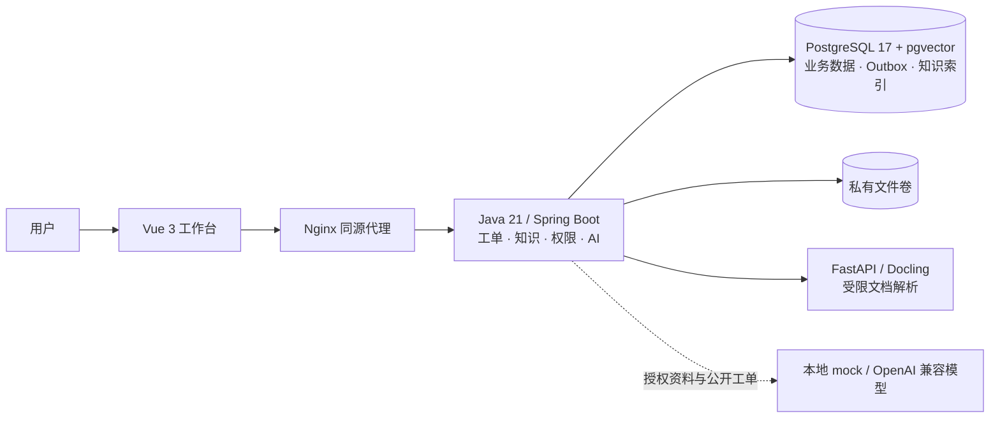

# Ticknova · AI 工单与知识协同平台

[](https://github.com/kevin-sanas/Ticknova/actions/workflows/verify.yaml)

把服务请求、经过审核的知识和有引用的 AI 建议连接起来，面向单组织、本地部署的企业服务台。

- **可追溯的 RAG**：文件经 Docling 解析、版本化分块与 1024 维索引，按当前权限过滤后进行全文/向量混合检索，回答关联真实文档版本和片段。
- **独立知识审核**：编辑草稿、不可变版本、另一位编辑审核、发布与撤回形成闭环；新版本未发布前保留旧内容。
- **完整工单流程**：队列与对象权限、领取分派、公开回复和内部备注隔离、状态历史、乐观锁与幂等请求。
- **人工掌握执行权**：AI 提供回复、摘要和分类建议；采纳填入草稿后，仍由用户确认发送或保存。



Java 承担业务与 AI 编排，Python 仅封装内部解析服务。前端使用 Vue、TypeScript、Pinia、Vue Router、Element Plus 和 Tiptap；数据库迁移以 `db/migration` 为唯一来源。

## 启动

准备 Docker Desktop 的 Linux 引擎 / Docker Engine 与 Compose，建议至少 8 GiB 可用内存。首次构建需要访问镜像及依赖源，宿主无需安装 Java、Node 或 Python。

Windows PowerShell，在项目根目录执行：

```powershell
.\scripts\Start-Local.ps1
```

Linux / macOS：

```sh
sh scripts/Start-Local.sh
```

打开 [127.0.0.1:5173](http://127.0.0.1:5173)。启动脚本生成本机私有配置，空库初始化 4 个队列、8 项服务、12 篇原创且已独立审核的知识，以及 24 张工单；已有数据和密码保留。演示模式固定为 **mock**，可提问“网络无法连接怎么办”“VPN 连不上”“怎么重置密码”。

账号：`admin`、`agent`、`requester`、`editor`、`reviewer`。当前密码仅保存在本机 `.env.demo` 的 `DEMO_<用户名大写>_PASSWORD`；首次初始化通过正常改密流程生成密码。审核由另一位具空间权限的知识编辑者从 **审核待办** 发起，作者不能自审，管理员也不能绕过空间阅读权限。

启动参数、原生平台验证范围、备份恢复及常见问题见[部署与运维](docs/11-本地部署运维与CI-CD.md)。

## 验证与当前边界

演示、浏览器回归、RAG 评测和性能测试使用不同的数据库与配置，测试不会向演示库写入合成数据。依赖、镜像和工具版本固定；GitHub 徽章展示远端工作流的实际状态，本地结果见[测试矩阵与阶段门](docs/12-测试矩阵与阶段门.md)。

真实百炼模型已有独立实跑，mock 用于离线演示和回归。评测使用开发者候选标签；人工 groundedness 与完整质量门仍未完成。服务端校验引用及部分可客观比对的具体细节，不将该校验宣称为全部事实正确性证明。模型、数据集、误例和测量条件见[RAG 设计与评测](docs/10-RAG设计与评测.md)。

本地基础负载实测（Docker Desktop Linux，16 vCPU / 8.22 GB，1,000张工单及12篇知识，预热后）：

| 操作 | 负载 / 样本 | P95 |
|---|---|---|
| 工单列表 | 50并发、5分钟、131,876次 | 38.97ms |
| 工单创建 | 50并发、500次 | 39.60ms |
| mock异步问答完成 | 2并发、30次 | 2.061s |

本轮HTTP错误0、500张工单落库及30次引用回答均核对通过；异步耗时含排队、检索、mock生成和轮询，不代表真实模型或生产承诺。[原始负载报告](docs/evidence/performance-mock-20261024T121400557Z.json)保留镜像、完整指标与环境；此前失败轮次见测试记录。

Docling/Pillow/pypdf 已完成兼容升级及解析依赖公告复测；容器 OS 与生产发布等边界仍见[许可证及依赖边界](docs/15-开源许可证与接口边界.md)。最终开源展示的截图/GIF将在视觉交付验收后补充。

## 阅读顺序

1. [产品目标与范围](docs/01-项目章程与PRD.md)
2. [架构与技术选型](docs/05-架构与技术选型.md)、[数据模型](docs/06-数据模型ERD与SQL.md)
3. [RAG 设计与评测](docs/10-RAG设计与评测.md)
4. [角色与业务用例](docs/02-角色用例与需求.md)、[API 契约](docs/07-API契约.md)
5. [部署与运维](docs/11-本地部署运维与CI-CD.md)、[实际测试记录](docs/12-测试矩阵与阶段门.md)
6. [开发流程说明](docs/开发流程说明.md)
