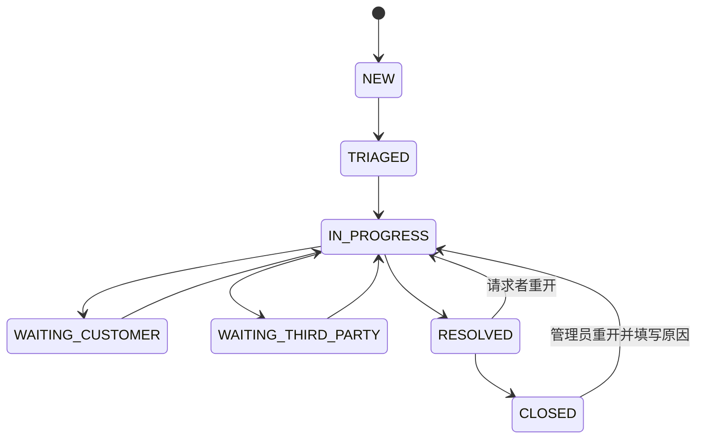
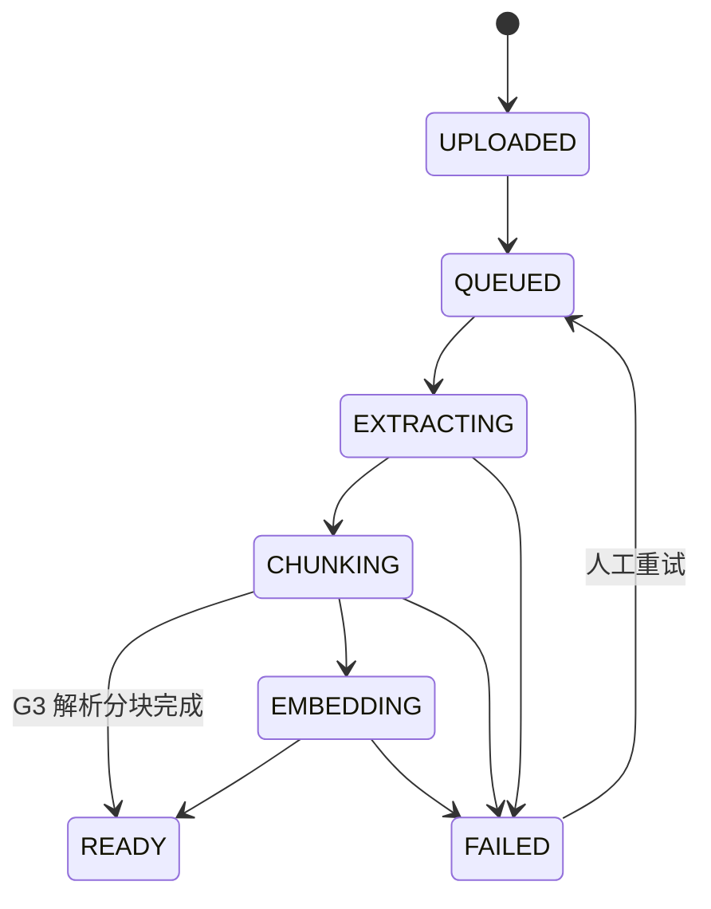

# 03｜领域模型与状态机

## 核心领域

- **Ticket**：问题载体，含编号、标题、描述、请求人、服务项、优先级、队列、处理人、状态和并发版本号。
- **TicketComment**：带 `PUBLIC_REPLY` 或 `INTERNAL_NOTE` 可见性；内容不可原位覆盖，编辑应产生审计记录。
- **KnowledgeSpace**：文档 ACL 边界；一个用户可拥有多个角色，但读取在每次检索时验证。
- **KnowledgeDocument**：逻辑文档；每次上传形成不可变 `DocumentVersion`，保存 hash、原文件位置、解析状态和发布状态。
- **KnowledgeChunk**：文档版本下的带序号内容片段，含标题路径、页码、文本、向量和 lexical 向量。
- **AiJob/AiSuggestion**：异步工作单及其结构化结果、模型版本、引用和用户反馈。
- **OutboxEvent/AuditEvent**：可靠传递和不可抵赖的业务记录。

## 工单状态机

规则：仅 `AGENT` 可处理 `TRIAGED/IN_PROGRESS/WAITING_*`；请求者只能从 `RESOLVED` 请求重开；关闭须已有解决说明；每次转换同时写入状态历史和审计；版本冲突返回 409，不覆盖并发修改。

## 文档状态机

摄取状态与发布状态分开：摄取状态只表示解析/索引阶段；版本发布状态为 `DRAFT/PUBLISHED/SUPERSEDED`，文档发布状态为 `DRAFT/PUBLISHED/DISABLED/ARCHIVED`。当前只有 `READY/APPROVED` 且有片段的版本能发布。`latest_version_id` 指最新上传版本；`published_version_id` 是当前检索唯一可用版本。新版本重建期间仍用旧发布版本；发布成功时同一事务更新指针、将旧版本标记 `SUPERSEDED` 并记录审计。撤回会清空发布指针并立即从检索过滤；失败版本不影响旧发布版本。`DISABLED` 是文档发布状态，不是摄取状态。

阶段历史：G3 的 `READY` 表示解析与分块成功，`embedding` 保持 NULL；发布允许已授权成员在知识页面阅读正文。G4 引入 embedding/检索，并须先完成索引版本校验，不能把 G3 的发布指针视为已经具备检索向量。

## 业务不变量

2026-10-24 当前知识规则：摄取、审核、发布是三个独立维度。审核状态为 `DRAFT → PENDING → APPROVED/REJECTED`；编辑者须具 `KB_EDITOR+canRead+canEdit` 才能提交当前最新、有片段且 `READY/DRAFT` 的版本。审核者须具 `KB_REVIEWER+canRead+canReview`，仅能审核当前精确 `READY/PENDING` 版本且不能是作者。拒绝后通过编辑形成新版本再提交；发布须 `READY/APPROVED` 且有片段，由编辑者执行，不由审核者执行。G4 检索另需匹配当前 profile 的就绪索引，审核批准不等于已发布或已可检索。

同一空间成员的编辑/审核 ACL 互斥。ADMIN 只凭本角色创建空间与管理成员，不隐含读正文、编辑或审核。文档级 `allowedActions` 描述草稿编辑、上传、归档、撤回；版本级 `allowedActions` 描述提交、审核、发布、解析/索引重试。服务端按每次请求的角色、ACL、作者与状态计算，不能把前端动作清单当授权凭证。

1. 编号在本部署唯一；客户端重复提交同一 `Idempotency-Key` 得到同一结果。
2. 工单公开回复和内部备注不可通过序列化映射混为一个字段。
3. 只从 `PUBLISHED` 且当前用户可读的知识片段检索；文档撤回后禁止新回答引用。
4. 分块唯一键为 `(document_version_id, chunk_index)`；任务重复消费不能重复插入。
5. 删除用户只停用登录并匿名化可匿名字段；保留审计对象的策略需文档化，不级联删除业务证据。
