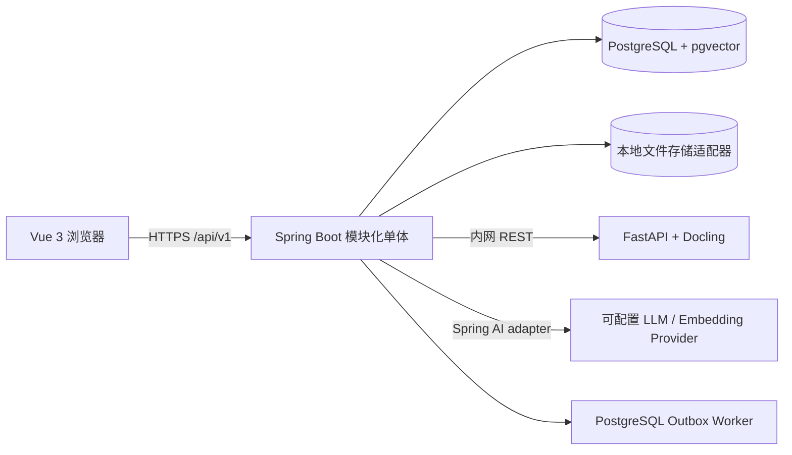

# 05｜架构与技术选型

## 逻辑架构

## 关键调用流程

上传文档：Vue → Spring 校验权限/大小/类型 → 文件存储 → 同事务写版本、任务和 Outbox → worker 调 Docling → 清洗并分块 → Spring AI 生成 embedding → pgvector/全文索引 → 标记 `READY`。问答：先校验用户与空间 → SQL ACL 过滤 → 向量/全文召回 → 构建带 chunk ID 的提示 → 模型输出结构化回答 → 校验引用 ID 均来自召回集合 → 保存建议并返回。

## 技术基线（2026-10-20 核验快照）

| 技术 | 决策 | 理由 / 边界 |
|---|---|---|
| Java | Java 21 LTS | Spring Boot 4 要求 Java 17+；21 作为工程基线 |
| 业务后端 | Spring Boot 4.1.x；当前观察到 4.1.1 GA | 生态主线、成熟安全与事务体系；实施前取该系列最新补丁 |
| AI | Spring AI 2.0.x；当前稳定版 2.0.1 | 官方文档说明支持 Boot 4.0/4.1；2.1.0-M1 是预览版，不纳入基线 |
| 前端 | Vue 3.5.x + TypeScript + Vite | 稳定版本线；3.6 RC 暂不用于基线 |
| 解析 | Python 3.12 + FastAPI + Docling 2.x | Docling Python SDK 的 `DocumentConverter` 作为库入口；HTTP 契约由本项目定义 |
| 数据 | PostgreSQL 17 + pgvector 0.8.x | 单库承载业务、Outbox、全文与向量检索，减少本地依赖 |
| 迁移/构建 | Maven Wrapper、Flyway、npm lock、uv lock | 可复现构建；禁止依赖浮动版本上线 |

版本快照不是永久承诺。G0 必须复核稳定 GA、兼容矩阵、许可证和漏洞，生成锁文件；不使用 milestone、RC 或 `latest` 镜像标签。

## 选择与取舍

### G4 当前实施补充

基于G3的四服务，新增Java内部的Spring AI2.0.1模型端口、分批向量索引器和AI任务worker；POM只引入chat-client/OpenAI模型模块，不用自动创建真实provider的starter。G3 READY不变，V4以独立embedding_state/profile/lease控制可检索性。新旧profile隔离，原生pgvector精确检索与中文分词全文召回合并，暂不建HNSW。默认mock确定性演示；真实模式显式配置，网络故障按有限任务失败处理，不将provider加入工单readiness。

### G0–G2 实际锁定（2026-10-20）

业务采用 Spring Boot 4.1.1 + Java 21 + JdbcClient/Flyway。供应链查询发现默认传递版本的安全公告后，在同系列锁定 Tomcat 11.0.27、Jackson 3 BOM 3.1.8、Jackson 2 BOM 2.21.8；完整回归和 OSV 复查见第 12/15 篇。前端 Vue 3.5.44、Vite 8.3.4、TypeScript 5.9.3、Element Plus 2.14.7、Pinia 4.1.0、Vue Router 5.4.0。PostgreSQL 实测 17.8，pgvector 0.8.1。实际镜像 tag/digest 以部署文件为准。

本轮 Compose 仅运行 postgres/api/web；Spring AI、Docling/Python 与模型权重尚未引入，版本/许可证在对应阶段重新核验。应用依赖清单见 `evidence/backend-bom.json` 和 `evidence/frontend-bom.json`。

- **模块化单体**：一个 Java 应用便于学生完成完整业务，模块边界保留未来拆分能力。
- **无额外 Redis/RabbitMQ**：首版用 PostgreSQL Outbox/任务租约，保持一条 `docker compose up` 的轻量本地路径。
- **pgvector**：避免独立向量数据库；公开资料显示支持精确搜索和 HNSW/IVFFlat 近似索引。数据较小时先用精确查询，测量后再启索引。
- **Docling 内嵌为独立 Python 服务**：重型解析依赖与 Java 解耦；不要把模型运行依赖引入主 API。
- **模型适配器**：模型供应商可替换；真实 provider 只由环境变量启用，默认 mock 便于本地离线演示。
