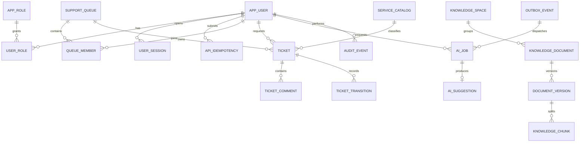

# 06｜数据模型、ERD 与 SQL

## 2026-10-24：V7 角色与空间审核权限

`V7__knowledge_reviewer_role.sql` 扩展 `app_role.code` 约束并插入 `KB_REVIEWER`，当前五角色为 `ADMIN/AGENT/REQUESTER/KB_EDITOR/KB_REVIEWER`。`knowledge_space_member.can_review boolean NOT NULL DEFAULT false` 保存审核 ACL，新增约束 `NOT can_review OR can_read` 与 `NOT (can_edit AND can_review)`；原编辑必须可读约束继续保留。角色和 ACL 在服务端同时生效，数据库 ACL 本身不替代角色校验。

V7 不按用户名转换现有账号角色，不覆盖密码、历史版本、审核记录或现有 ACL。旧库需要由管理员通过受控配置明确授予审核角色及空间 `canRead+canReview`，并撤销同空间编辑 ACL。新空库 DemoSeed 生成五个独立角色账号；已存在用户时跳过，不将旧库冒充新种子库。

API 中 Space 增加有效 `canReview`；Member 增加 `roles,canReview`，Candidate 增加 `roles`；Membership 输入为 `{canRead,canEdit,canReview,reason}`。文档和版本的 `allowedActions` 是动态响应字段，不作为表字段持久化。门户 `publishedAt` 读取当前发布版本的真实 `published_at`，分类 `documentCount` 按当前 ACL 下的有效发布文档直接所属分类计数，不累计子树。

## Ticknova V2：V5/V6 增量

结构唯一来源仍是根目录Flyway迁移。V5增加空间隔离的knowledge_category、CAS knowledge_draft、文档category_id及版本审核字段、不可变authored_title/category和rich_content/rich_fingerprint。旧已发布版本以review_grandfathered保留APPROVED，不伪造审核人；新版本默认DRAFT，审核人不得为版本作者。原件SHA、存储键、作者及rich快照由数据库触发器保护。

同源文件按文档/SHA/创作元数据、文章按rich fingerprint去重，REJECTED除外。新提交复用历史快照时，在锁内更新latest并审计；旧幂等key重放不回退后续latest。发布指针独立，新草稿、解析或审核不改变当前公开内容。

V6增加真实每日文档浏览去重表，以及AI中止CANCELLED状态和对应Outbox终态。工单状态枚举不变。V4→V6演示数据保留核验见 `evidence/ui-v2-demo-upgrade.json`。

> 下文是全产品设计基线；真实结构以根目录 `db/migration` 为唯一来源。V1/V2 实现身份与工单；V3 增加知识空间/成员、文档/版本/分块、摄取任务与 Outbox。V4 增加模型 profile、分批 embedding 状态/租约、全文 GIN 索引，以及 `ai_request`、`ai_suggestion`、`ai_citation`、`ai_context_source`。AI_REQUEST 与 DOCUMENT_INGEST 独立消费；当前未启用 HNSW。

V4 请求持久保存创建时的有效空间集合；`ai_context_source` 保存实际提供给模型的全部知识片段，与模型最终选出的可见引用分开。读取、反馈及完成时重新检查原始空间和所有来源，撤回后结果被保守隐藏。摘要和分类只使用公开工单上下文。物理清理需在 G5 按来源/引用外键顺序设计，当前软归档不删除原件。

## ERD



## 建议目录和字段

主键 UUID；时间为 `timestamptz` UTC；所有可见数据有创建人和时间。通过 Flyway 维护迁移，不在 ORM 启动时自动建表。密码只存 Argon2id/bcrypt 哈希。

```sql
CREATE EXTENSION IF NOT EXISTS vector;

CREATE TABLE app_user (
  id uuid PRIMARY KEY,
  username varchar(80) NOT NULL UNIQUE,
  password_hash text NOT NULL,
  display_name varchar(120) NOT NULL,
  active boolean NOT NULL DEFAULT true,
  created_at timestamptz NOT NULL DEFAULT now()
);
CREATE TABLE app_role (
  id uuid PRIMARY KEY,
  code varchar(40) NOT NULL UNIQUE
    CHECK (code IN ('ADMIN','AGENT','KB_EDITOR','KB_REVIEWER','REQUESTER'))
);
CREATE TABLE user_role (
  user_id uuid NOT NULL REFERENCES app_user(id),
  role_id uuid NOT NULL REFERENCES app_role(id),
  PRIMARY KEY (user_id, role_id)
);
CREATE TABLE user_session (
  id uuid PRIMARY KEY,
  user_id uuid NOT NULL REFERENCES app_user(id),
  token_hash char(64) NOT NULL UNIQUE,
  expires_at timestamptz NOT NULL,
  revoked_at timestamptz,
  created_at timestamptz NOT NULL DEFAULT now()
);
CREATE TABLE api_idempotency (
  id uuid PRIMARY KEY,
  user_id uuid NOT NULL REFERENCES app_user(id),
  operation varchar(100) NOT NULL,
  idempotency_key varchar(128) NOT NULL,
  request_hash char(64) NOT NULL,
  state varchar(16) NOT NULL CHECK (state IN ('IN_PROGRESS','COMPLETED')),
  response_status smallint,
  response_resource_id uuid,
  created_at timestamptz NOT NULL DEFAULT now(),
  expires_at timestamptz NOT NULL,
  UNIQUE(user_id,operation,idempotency_key),
  CHECK ((state='IN_PROGRESS' AND response_status IS NULL) OR
         (state='COMPLETED' AND response_status BETWEEN 200 AND 299))
);
CREATE INDEX api_idempotency_expiry_idx ON api_idempotency(expires_at);
CREATE TABLE support_queue (
  id uuid PRIMARY KEY,
  code varchar(80) NOT NULL UNIQUE,
  name varchar(160) NOT NULL,
  active boolean NOT NULL DEFAULT true
);
CREATE TABLE queue_member (
  queue_id uuid NOT NULL REFERENCES support_queue(id),
  user_id uuid NOT NULL REFERENCES app_user(id),
  can_process boolean NOT NULL DEFAULT true,
  PRIMARY KEY(queue_id,user_id)
);
CREATE TABLE service_catalog (
  id uuid PRIMARY KEY,
  code varchar(60) NOT NULL UNIQUE,
  name varchar(160) NOT NULL,
  active boolean NOT NULL DEFAULT true
);
CREATE TABLE ticket (
  id uuid PRIMARY KEY,
  ticket_no bigint GENERATED ALWAYS AS IDENTITY UNIQUE,
  title varchar(200) NOT NULL,
  description text NOT NULL,
  requester_id uuid NOT NULL REFERENCES app_user(id),
  service_id uuid REFERENCES service_catalog(id),
  assignee_id uuid REFERENCES app_user(id),
  queue_id uuid NOT NULL REFERENCES support_queue(id),
  priority varchar(16) NOT NULL DEFAULT 'NORMAL'
    CHECK (priority IN ('LOW','NORMAL','HIGH','URGENT')),
  status varchar(32) NOT NULL DEFAULT 'NEW'
    CHECK (status IN ('NEW','TRIAGED','IN_PROGRESS','WAITING_CUSTOMER',
      'WAITING_THIRD_PARTY','RESOLVED','CLOSED')),
  version bigint NOT NULL DEFAULT 0,
  created_at timestamptz NOT NULL DEFAULT now(),
  updated_at timestamptz NOT NULL DEFAULT now()
);
CREATE TABLE ticket_comment (
  id uuid PRIMARY KEY,
  ticket_id uuid NOT NULL REFERENCES ticket(id),
  author_id uuid NOT NULL REFERENCES app_user(id),
  visibility varchar(24) NOT NULL CHECK (visibility IN ('PUBLIC_REPLY','INTERNAL_NOTE')),
  body text NOT NULL,
  created_at timestamptz NOT NULL DEFAULT now()
);
CREATE TABLE ticket_transition (
  id uuid PRIMARY KEY,
  ticket_id uuid NOT NULL REFERENCES ticket(id),
  actor_id uuid NOT NULL REFERENCES app_user(id),
  from_status varchar(32) NOT NULL,
  to_status varchar(32) NOT NULL,
  reason text,
  created_at timestamptz NOT NULL DEFAULT now()
);
CREATE TABLE knowledge_space (
  id uuid PRIMARY KEY,
  name varchar(160) NOT NULL,
  active boolean NOT NULL DEFAULT true,
  created_by uuid NOT NULL REFERENCES app_user(id),
  created_at timestamptz NOT NULL DEFAULT now()
);
CREATE TABLE knowledge_space_member (
  space_id uuid NOT NULL REFERENCES knowledge_space(id),
  user_id uuid NOT NULL REFERENCES app_user(id),
  can_read boolean NOT NULL DEFAULT true,
  can_edit boolean NOT NULL DEFAULT false,
  can_review boolean NOT NULL DEFAULT false,
  PRIMARY KEY(space_id,user_id), CHECK (NOT can_edit OR can_read),
  CHECK (NOT can_review OR can_read), CHECK (NOT (can_edit AND can_review))
);
CREATE TABLE knowledge_document (
  id uuid PRIMARY KEY,
  space_id uuid NOT NULL REFERENCES knowledge_space(id),
  title varchar(240) NOT NULL,
  latest_version_id uuid,
  published_version_id uuid,
  publication_state varchar(16) NOT NULL DEFAULT 'DRAFT'
    CHECK (publication_state IN ('DRAFT','PUBLISHED','DISABLED','ARCHIVED')),
  created_by uuid NOT NULL REFERENCES app_user(id),
  created_at timestamptz NOT NULL DEFAULT now()
);
CREATE TABLE document_version (
  id uuid PRIMARY KEY,
  document_id uuid NOT NULL REFERENCES knowledge_document(id),
  version_no integer NOT NULL,
  file_name varchar(255) NOT NULL,
  mime_type varchar(120) NOT NULL,
  sha256 char(64) NOT NULL,
  storage_key text NOT NULL,
  ingest_state varchar(20) NOT NULL DEFAULT 'UPLOADED'
    CHECK (ingest_state IN ('UPLOADED','QUEUED','EXTRACTING','CHUNKING','EMBEDDING','READY','FAILED')),
  publication_state varchar(16) NOT NULL DEFAULT 'DRAFT'
    CHECK (publication_state IN ('DRAFT','PUBLISHED','SUPERSEDED')),
  published_at timestamptz,
  error_code varchar(80),
  created_by uuid NOT NULL REFERENCES app_user(id),
  created_at timestamptz NOT NULL DEFAULT now(),
  UNIQUE(document_id,version_no), UNIQUE(document_id,sha256)
);
ALTER TABLE knowledge_document ADD CONSTRAINT fk_document_latest_version
  FOREIGN KEY(latest_version_id) REFERENCES document_version(id);
ALTER TABLE knowledge_document ADD CONSTRAINT fk_document_published_version
  FOREIGN KEY(published_version_id) REFERENCES document_version(id);
ALTER TABLE document_version ADD CONSTRAINT uq_document_version_parent
  UNIQUE(document_id,id);
ALTER TABLE knowledge_document ADD CONSTRAINT fk_latest_version_same_document
  FOREIGN KEY(id,latest_version_id) REFERENCES document_version(document_id,id)
  DEFERRABLE INITIALLY DEFERRED;
ALTER TABLE knowledge_document ADD CONSTRAINT fk_published_version_same_document
  FOREIGN KEY(id,published_version_id) REFERENCES document_version(document_id,id)
  DEFERRABLE INITIALLY DEFERRED;
CREATE TABLE knowledge_chunk (
  id uuid PRIMARY KEY,
  document_version_id uuid NOT NULL REFERENCES document_version(id) ON DELETE CASCADE,
  chunk_index integer NOT NULL,
  page_no integer,
  heading_path text,
  content text NOT NULL,
  search_tsv tsvector GENERATED ALWAYS AS (to_tsvector('simple', content)) STORED,
  embedding vector(1024),
  created_at timestamptz NOT NULL DEFAULT now(),
  UNIQUE(document_version_id,chunk_index)
);
CREATE TABLE ai_job (
  id uuid PRIMARY KEY,
  requested_by uuid NOT NULL REFERENCES app_user(id),
  job_type varchar(32) NOT NULL,
  subject_type varchar(32) NOT NULL,
  subject_id uuid NOT NULL,
  status varchar(20) NOT NULL DEFAULT 'QUEUED',
  attempt_count integer NOT NULL DEFAULT 0,
  idempotency_key varchar(160) NOT NULL UNIQUE,
  result_json jsonb,
  error_code varchar(80),
  created_at timestamptz NOT NULL DEFAULT now(),
  updated_at timestamptz NOT NULL DEFAULT now()
);
CREATE TABLE ai_suggestion (
  id uuid PRIMARY KEY,
  job_id uuid NOT NULL UNIQUE REFERENCES ai_job(id),
  suggestion_type varchar(32) NOT NULL,
  content text NOT NULL,
  citations_json jsonb NOT NULL DEFAULT '[]',
  model_name varchar(120),
  model_version varchar(120),
  feedback varchar(16) CHECK (feedback IN ('ACCEPTED','REJECTED')),
  feedback_reason text,
  feedback_by uuid REFERENCES app_user(id),
  feedback_at timestamptz
);
CREATE TABLE outbox_event (
  id uuid PRIMARY KEY,
  event_type varchar(120) NOT NULL,
  aggregate_type varchar(80) NOT NULL,
  aggregate_id uuid NOT NULL,
  payload jsonb NOT NULL,
  state varchar(16) NOT NULL DEFAULT 'PENDING',
  attempts integer NOT NULL DEFAULT 0,
  available_at timestamptz NOT NULL DEFAULT now(),
  locked_until timestamptz,
  last_error_code varchar(80),
  created_at timestamptz NOT NULL DEFAULT now()
);
CREATE TABLE audit_event (
  id uuid PRIMARY KEY,
  actor_id uuid REFERENCES app_user(id),
  action varchar(100) NOT NULL,
  subject_type varchar(80) NOT NULL,
  subject_id uuid,
  trace_id varchar(80),
  metadata jsonb NOT NULL DEFAULT '{}',
  created_at timestamptz NOT NULL DEFAULT now()
);
CREATE INDEX ix_ticket_queue_status_updated ON ticket(queue_id,status,updated_at DESC);
CREATE INDEX ix_ticket_requester_created ON ticket(requester_id,created_at DESC);
CREATE INDEX ix_comment_ticket_created ON ticket_comment(ticket_id,created_at);
CREATE INDEX ix_queue_member_user ON queue_member(user_id,queue_id);
CREATE INDEX ix_document_space_state ON knowledge_document(space_id,publication_state);
CREATE INDEX ix_version_state ON document_version(ingest_state,created_at);
CREATE INDEX ix_outbox_pending ON outbox_event(available_at,created_at) WHERE state='PENDING';
CREATE INDEX ix_audit_subject_created ON audit_event(subject_type,subject_id,created_at DESC);
-- G3/G4 在固定评测集比较精确召回后，再按实测决定是否引入此索引：
-- CREATE INDEX ix_chunk_embedding_hnsw ON knowledge_chunk USING hnsw(embedding vector_cosine_ops);
CREATE INDEX ix_chunk_search_tsv ON knowledge_chunk USING gin(search_tsv);
```

### 重要实施说明

- `vector(1024)` 是产品基线约定，不是任意 embedding 模型都天然兼容。部署必须校验模型输出维度；更换维度需要新列/重建索引/全量重嵌入迁移。
- `latest_version_id` 和 `published_version_id` 必须指向同一个 document 的版本；应用服务在事务中保证，并建议用 `(document_id,id)` 复合外键加强约束。
- 检索必须 join `knowledge_document.published_version_id = knowledge_chunk.document_version_id` 且版本/文档状态有效、空间 ACL 可读。全文与向量候选都先在同一 ACL 过滤范围中取数，再做 RRF；不得先全局搜索后过滤。
- `support_queue` 初始化 `GENERAL` 队列；仅有 `AGENT` 且在 `queue_member` 的用户能查看/处理对应队列，ADMIN 的跨队列读取也按显式策略审计。
- `user_session` 保存随机 token 的 HMAC-SHA256/pepper 摘要；pepper 不入库。验证用户 active、未撤销、未过期后加载角色。
- `api_idempotency` 为创建型写 API 保留 24 小时键、请求摘要和资源 ID，不缓存正文；重放时重新检查资源权限并构造原响应。过期记录由定时清理任务删除。
- HNSW 索引在样本很小时未必更快；需在目标数据集上用 `EXPLAIN ANALYZE` 验证。全文检索首版即使用生成列 `search_tsv` 与 GIN 索引；按 ACL 过滤后的候选再和向量候选合并。
- 演示 DDL 是设计基线，实施时须写成增量 Flyway 文件并补约束/索引迁移测试。
